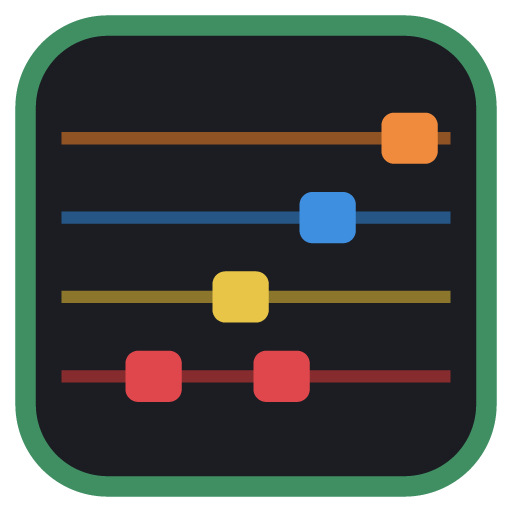

# FretWright

Turn any song into a playable **Rocksmith 2014 bass arrangement**: AI bass
detection, a tab editor with playback, and `.psarc` building. One program,
written in Rust: no Python, no Wwise, no Wine, no Windows tools.

```
song.mp3 ─► Demucs (bass stem, on your GPU) ─► Beat This! + pYIN ─► editor ─► .psarc
```

<p align="center"></p>

## Install

Download the bundle for your system from the
[releases page](../../releases) and run `fretwright` (Linux: the `.AppImage`, or
`fretwright` from the `.tar.gz`; Windows: `fretwright.exe`; macOS: `FretWright.app`).
On first start it offers to download its AI models (about 420 MB, checked
against published SHA-256 sums).

From source (needs [Rust](https://rustup.rs); on Linux also the ALSA headers,
e.g. `libasound2-dev` / `alsa-lib`):

```bash
./run.sh            # Linux / macOS
run.bat             # Windows
```

## Using the app

1. **File → New Project** and pick the song. Artist and title are guessed from
   the file name; album art next to the song is picked up.
2. **Detection** tab: press *Detect bass line*. *Compare models…* tries several
   separators and scores them so you can load the best.
3. Fix things in the editor. Listen with *Full mix + chart synth* to hear the
   chart against the song, and slow down to 0.5x (pitch stays the same) for fast
   passages. **Help → Editor shortcuts** lists everything; the essentials:
   - click/drag notes, drag a note's right edge to change its length, double-click a lane to add one
   - type digits to set the fret, Up/Down for pitch, Shift+Up/Down to change string
   - H P M A S toggle hammer-on, pull-off, mute, accent, slide
   - Delete removes, Ctrl+Z undoes, Space plays
   - right-click a beat line to make it the start of a bar
4. **Build** tab: *Build .psarc*. The package lands in `<project>/out`; copy it
   to Rocksmith's `dlc` folder.

The full guide is in [docs/USER_GUIDE.md](docs/USER_GUIDE.md).

## Command line

```bash
fretwright-cli convert "Artist - Song.mp3"           # song to .psarc in one step
fretwright-cli convert song.flac --art cover.jpg --tuning "Drop D" --platform pc,mac
fretwright-cli detect <project>                      # re-run detection on a project
fretwright-cli build <project>                       # build a project's .psarc
fretwright-cli models download [--all]               # fetch the AI models
fretwright-cli psarc list|extract|pack ...           # archive tools
fretwright-cli --help
```

## What's inside

| Stage | How |
|-------|-----|
| Bass separation | Meta's Demucs v4 (fine-tuned, standard or 6-stem) via [demucs-rs](https://github.com/nikhilunni/demucs-rs) on any Vulkan, Metal or DX12 GPU (or the CPU); or a plain low-pass filter |
| Beats and bars | [Beat This!](https://github.com/CPJKU/beat_this) (ISMIR 2024) on [rten](https://github.com/robertknight/rten), or a classic tracker |
| Pitch and notes | pYIN, onset detection and note segmentation ported from librosa, then a string/fret optimiser |
| Charting | phrases, sections and dynamic difficulty, ported from [Rocksmith2014.NET](https://github.com/iminashi/Rocksmith2014.NET) |
| Audio | Wwise 2013 Vorbis `.wem` via [rabbit-smith/wem](https://github.com/rabbit-smith/wem), so Wwise is not needed |
| Packaging | SNG, manifests, sound banks and encrypted PSARC, written from scratch in Rust |

Parts of FretWright are Rust ports of these projects, each checked against
the original (PyTorch, librosa, Rocksmith2014.NET); the credits are in
[LICENSES/](LICENSES/README.md).

## Developing

```
crates/fw-app       the desktop app (egui)
crates/fw-cli       the fretwright-cli command line tool
crates/fw-detect    signal processing: pYIN, onsets, beats, notes, fretting
crates/fw-models    neural networks: Beat This!, Demucs, model downloads
crates/fw-project   project files, chart conversion, build pipeline
crates/fw-package   manifests, sound banks, album art, packaging
crates/fw-{psarc,sng,xml,convert,improve,dd,audio}   formats, charting and audio
crates/xtask         release packaging (cargo xtask package)
third_party/         vendored wem and demucs-core (see PATCHES.md)
LICENSES/            licences of the works FretWright is ported from
```

```bash
cargo test --workspace --release
cargo clippy --workspace --all-targets
cargo xtask package             # release bundle in dist/
```

See [CONTRIBUTING.md](CONTRIBUTING.md) and [docs/RELEASING.md](docs/RELEASING.md).

## Licenses

FretWright is MIT licensed. Parts are ports of Rocksmith2014.NET (MIT), librosa
(ISC), SciPy (BSD-3-Clause) and Beat This! (MIT); see
[LICENSES/](LICENSES/README.md). Vendored code keeps its own licence: wem (MIT
or Apache-2.0), demucs-rs (Apache-2.0). The model weights are Demucs (Meta,
MIT) and Beat This! (JKU Linz, MIT), see [docs/MODELS.md](docs/MODELS.md).
Release bundles include `THIRD_PARTY_LICENSES.txt` with every dependency's
licence.

Rocksmith is a trademark of Ubisoft. FretWright is not affiliated with or endorsed
by Ubisoft.
