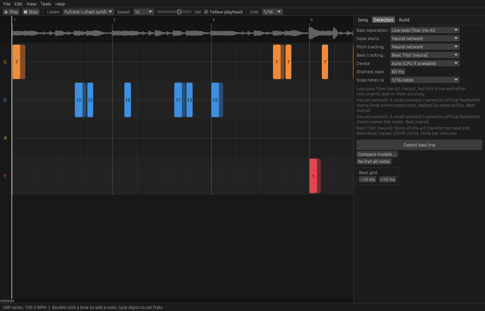
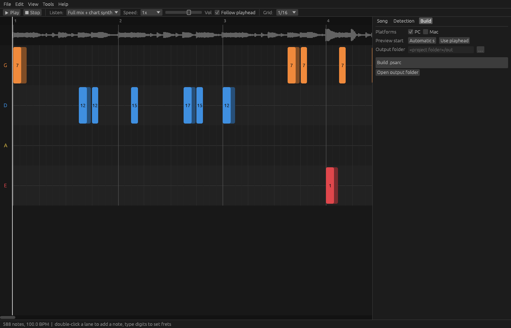

#  FretWright

**Turn any song into a playable Rocksmith 2014 bass arrangement.**

AI bass detection, a tab editor with playback, and `.psarc` and `.feedpak` building, in one desktop app. No Python, no Wwise, no Wine, no Windows tools.

> **Early access (v0.x).** It works end to end, but today's AI models are small: on songs they haven't seen, they get about three in four bass notes right (73.5% average F1 on our 20-song test set), and they don't detect chords, slides or bends yet. Expect to correct charts in the editor. 1.0 will come with much larger models trained on far more songs.

## Features

- **Detects the bass line for you**: separates the bass on your GPU, finds the beats, and charts the notes
- **Tab editor with playback**: hear the chart against the song, and slow down to half speed without changing pitch
- **Every technique**: hammer-ons, pull-offs, slides, bends, harmonics, palm mutes and more, marked in the editor
- **Builds real Rocksmith packages**: `.psarc` for PC and Mac with dynamic difficulty, or [`.feedpak`](https://github.com/got-feedback/feedpak-spec) for feedBack
- **Command-line tool** to convert a song in one step
- **Light and dark themes** that follow your system

## Download

Get the bundle for your system from the [releases page](../../releases):

- **Linux:** `.AppImage` or `.tar.gz`
- **Windows:** `fretwright.exe` in a `.zip`
- **macOS:** `FretWright.app`

On first start it offers to download its AI models (about 420 MB, checked against published SHA-256 sums). The [user guide](docs/USER_GUIDE.md) walks you from a song to a finished package.

## Licence

Free and open source under the [GNU GPL v3 or later](LICENSE). Parts are ports of Rocksmith2014.NET, librosa, SciPy and Beat This!; all credits are in [LICENSES/](LICENSES/README.md). Want to build it yourself? See [BUILDING.md](BUILDING.md).

Screenshots show "Funkorama" by Kevin MacLeod ([incompetech.com](https://incompetech.com)), licensed under [CC BY 4.0](https://creativecommons.org/licenses/by/4.0/), with the notes exactly as FretWright detected them. Rocksmith is a trademark of Ubisoft. FretWright is not affiliated with or endorsed by Ubisoft.
